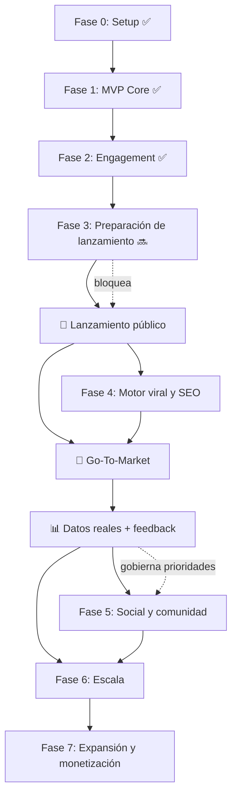

# 🗺️ CinePOV — Roadmap de Desarrollo
> Documento vivo que define las fases de construcción del proyecto, desde el setup inicial hasta la escala.
**Última actualización:** Julio 2026
**Referencias:** [Plan de Proyecto](./plan_proyecto.md) · [Go-To-Market](./go_to_market.md)
---
## Visión general del Roadmap
```
FASE 0        FASE 1        FASE 2        FASE 3         FASE 4         FASE 5        FASE 6        FASE 7
Setup &       MVP Core      Engagement    Preparación    Motor Viral    Social &      Escala &      Expansión &
Fundamentos   Funcional     & Retención   Lanzamiento    & SEO          Comunidad     Rendimiento   Monetización
──✅──────►───✅──────►───✅──────►────🔜─────►─────────►──────────►──────────►──────────►
Sem 1-2       Sem 3-8       Sem 9-12      Sem 13-15      Sem 16-19      Sem 20-23     Sem 24-28     Sem 29+
                                          🚀 LANZAMIENTO PÚBLICO
```
### Principio de secuenciación
La versión anterior de este roadmap situaba las palancas de crecimiento (imágenes OG, páginas virales, SEO, perfil cinematográfico) en las semanas 16-25, **después** de features sociales como reseñas y listas. Esa ordenación está corregida deliberadamente:

- **El SEO compone.** Cada semana sin fichas indexadas es tráfico orgánico perdido de forma permanente, no diferida.
- **Una ficha sin imagen OG es un enlace que nadie comparte.** Días de coste, todo el crecimiento orgánico del período en juego.
- **Reseñas y listas retienen, no adquieren.** Mejoran la vida de quien ya está dentro y añaden carga de moderación. Con base de usuarios pequeña su impacto es marginal.

> **Regla ante cualquier duda de priorización:** gana la tarea que produzca más valoraciones demográficas reales por unidad de esfuerzo.

### Nota sobre las estimaciones temporales
Las semanas son unidades de esfuerzo relativo, no fechas de calendario. El ritmo real de ejecución de las Fases 0-2 ha sido muy superior al estimado gracias al desarrollo asistido. Úsense para ordenar y dimensionar, no para comprometer fechas.
---
## FASE 0 — Setup y Fundamentos (Semanas 1-2) ✅
> **Objetivo:** Tener toda la infraestructura lista para empezar a desarrollar funcionalidades sin bloqueos.
### 0.1 — Configuración del entorno de desarrollo
- [x] Inicializar repositorio Git local (GitHub remoto pendiente de crear por usuario)
- [x] Configurar rama principal (`main`) + rama de desarrollo (`dev`) locales
- [x] Definir convenciones: commits (Conventional Commits), naming, estructura de carpetas (en README.md)
- [x] Configurar linter (ESLint) y formatter (Prettier) con reglas del proyecto
- [x] Configurar TypeScript con modo estricto (verificado en tsconfig.json)
### 0.2 — Inicialización del proyecto Next.js
- [x] Crear proyecto Next.js con App Router + TypeScript
- [x] Configurar estructura de carpetas: `/app`, `/components`, `/lib`, `/types`, `/public`
- [x] Instalar dependencias base: Prisma, NextAuth, Recharts/Nivo
- [x] Configurar variables de entorno (`.env.local`, `.env.example`)
- [x] Verificar que el proyecto arranca correctamente en local (servidor activo en localhost:3000)
### 0.3 — Base de datos
- [x] Provisionar PostgreSQL (usado SQLite localmente por decisión técnica en desarrollo)
- [x] Configurar Prisma: inicializar, conectar a la BD
- [x] Diseñar y crear el schema de Prisma con todas las entidades del MVP:
  - `User` (id, email, passwordHash, displayName, birthYear, gender, createdAt, avatarUrl)
  - `Movie` (id, tmdbId, title, originalTitle, year, synopsis, posterUrl, backdropUrl, genres, director, runtime, tmdbRating, cachedAt)
  - `Rating` (id, userId, movieId, score, createdAt, updatedAt)
- [x] Ejecutar primera migración
- [x] Crear seed script con datos de prueba (10 usuarios ficticios, 20 películas, 100 valoraciones)
> ⚠️ **Deuda técnica crítica arrastrada:** la base de datos en uso es **SQLite con `better-sqlite3`**, no PostgreSQL. Esto no es desplegable en producción sobre Vercel (filesystem efímero y de solo lectura). Se resuelve en la Fase 3.1, que es bloqueante de lanzamiento.
### 0.4 — Integración TMDB
- [x] Obtener API key de TMDB (cuenta gratuita)
- [x] Crear módulo de servicio TMDB (`/lib/tmdb.ts`):
  - Búsqueda de películas por título
  - Obtener detalle de película por ID
  - Obtener imágenes (póster, backdrop)
  - Obtener créditos (director, reparto)
- [x] Probar las llamadas y verificar estructura de respuesta (mediante scratch/test_tmdb.ts)
- [x] Definir estrategia de caché local (guardar película en BD tras primera consulta, implementado en lib/movies.ts)
### 0.5 — Sistema de diseño base
- [x] Definir paleta de colores, tipografía (Geist Sans/Mono), espaciados (en globals.css)
- [x] Crear archivo de tokens CSS (variables globales bajo @theme en globals.css compatible con Tailwind v4)
- [x] Definir componentes base de layout: Header, Footer, Container, Grid (Header.tsx y Footer.tsx integrados)
- [x] Configurar responsive breakpoints (gestionados nativamente por Tailwind CSS v4)
- [x] Crear favicon y meta tags base (configurados en Metadata de layout.tsx y favicon.ico provisto)
**📦 Entregable Fase 0:** Proyecto funcional que arranca, conectado a BD con schema migrado, TMDB respondiendo, y sistema de diseño base definido.
---
## FASE 1 — MVP Core Funcional (Semanas 3-8) ✅
> **Objetivo:** Construir las funcionalidades mínimas para que un usuario pueda registrarse, valorar películas y ver el desglose demográfico. Este es el corazón del producto.
### 1.1 — Autenticación y registro (Semana 3)
#### 1.1.1 — Backend de autenticación
- [x] Configurar NextAuth.js con provider de credenciales (email + contraseña) (en lib/auth.ts y app/api/auth/[...nextauth])
- [x] Configurar provider OAuth de Google (esqueleto listo en lib/auth.ts, requiere rellenar variables en .env)
- [x] Implementar endpoints de registro con campos demográficos (birthYear, gender) (en app/api/auth/register)
- [x] Validaciones: email único, contraseña segura, birthYear razonable (1920-2012), gender en enum (validadas en api/auth/register)
- [x] Hasheo de contraseñas (bcrypt) (implementado en api/auth/register)
- [x] Manejo de sesiones (JWT) (callbacks configurados en lib/auth.ts e interfaces en types/next-auth.d.ts)
- [x] Configurar secretos y variables de entorno para NextAuth (NEXTAUTH_SECRET y NEXTAUTH_URL) (ejemplos añadidos en .env.example)
#### 1.1.2 — Páginas de autenticación
- [x] Página de registro (`/register`): (implementado en app/register/page.tsx)
  - Formulario: email, contraseña, nombre público, año de nacimiento, género
  - Selector de género: Hombre, Mujer, No binario, Prefiero no decirlo
  - Selector de año de nacimiento (dropdown de años 1920-2020)
  - Texto explicativo de por qué se piden datos demográficos
  - Botón de registro con Google (esqueleto funcional visual)
- [x] Página de login (`/login`): (implementado en app/login/page.tsx)
  - Email + contraseña
  - Login con Google (llamada OAuth de NextAuth configurada)
  - Link a registro
- [x] Redirección post-login a la página principal (con refresco dinámico en Header.tsx)
- [x] Manejo de errores (email ya registrado, credenciales incorrectas) (controlado e impreso con estilos)
- [x] Flujo de Onboarding Express para registrar datos demográficos tras iniciar sesión con Google/OAuth (cuando `birthYear` o `gender` son nulos) (implementado en welcome/page.tsx, api/auth/complete-profile y middleware.ts)
#### 1.1.3 — Middleware y protección de rutas
- [x] Middleware de autenticación para rutas protegidas (en middleware.ts protegiendo /profile e /import)
- [x] Componente de estado de sesión en el header (avatar, nombre, logout) (integrado de forma dinámica en Header.tsx)
---
### 1.2 — Catálogo y búsqueda de películas (Semana 4)
#### 1.2.1 — Buscador
- [x] Componente de barra de búsqueda con debounce (300ms) (implementado en components/SearchBar.tsx)
- [x] API endpoint `/api/movies/search?q=` que consulta TMDB (en app/api/movies/search/route.ts)
- [x] Resultados en dropdown con: póster miniatura, título, año (diseño premium en SearchBar.tsx)
- [x] Al seleccionar un resultado → navegar a la ficha de película (redirige a /movie/[tmdbId])
- [x] Si la película no existe en BD local → crearla desde los datos de TMDB (importado de forma asíncrona mediante getOrCreateMovie en la carga de la página)
#### 1.2.2 — Ficha de película (datos básicos)
- [x] Página dinámica `/movie/[id]` (implementado en app/movie/[id]/page.tsx)
- [x] Layout de ficha: póster grande, backdrop como hero, título, año, director, duración, géneros (maquetación CSS premium)
- [x] Sinopsis completa
- [x] Reparto principal (primeros 5-8 actores) (agregado al modelo Movie y extraído de TMDB en getMovieWithCredits)
- [x] Nota media global de CinePOV (si hay valoraciones) (calculado asíncronamente en tiempo real en la página)
- [x] Nota de TMDB como referencia
- [x] Diseño responsive (mobile-first)
#### 1.2.3 — Página de exploración
- [x] Página `/explore` con secciones: (implementado en app/explore/page.tsx)
  - "Populares" (películas con más valoraciones en CinePOV de la BD local)
  - "Tendencias" (películas populares en TMDB esta semana por API)
  - "Añadidas recientemente" (últimas películas cacheadas en la BD local)
- [x] Grid de pósters con título, año y nota media (tarjetas interactivas con hover effects en CSS)
- [x] Paginación o scroll infinito (optimizado mediante grillas de 6 elementos destacados por sección, complementado por la barra de búsqueda global)
---
### 1.3 — Sistema de valoraciones (Semana 5)
#### 1.3.1 — Crear y editar valoración
- [x] Componente de valoración interactivo (escala 1-10): (implementado en components/RatingWidget.tsx)
  - Botones numéricos 1-10 (más preciso, estilo Filmaffinity) con animaciones hover y active
- [x] API endpoint `POST /api/ratings` (crear valoración con upsert y decaimiento en app/api/ratings/route.ts)
- [x] API endpoint `PUT /api/ratings/[id]` (actualizar valoración, resuelto en el mismo POST de upsert)
- [x] API endpoint `DELETE /api/ratings/[id]` (eliminar valoración mediante DELETE en api/ratings/route.ts)
- [x] Restricción: una sola valoración por usuario y película (clave compuesta única y upsert en prisma/schema.prisma)
- [x] Algoritmo de reemplazo: borrar 1 valoración artificial (`isArtificial: true`) por cada valoración real insertada (implementado en el POST de api/ratings)
- [x] Feedback visual inmediato al valorar (cambio instantáneo de promedio global y contador con estados de éxito reactivos)
#### 1.3.2 — Mostrar estado de valoración del usuario
- [x] En la ficha de película, mostrar si el usuario ya la ha valorado (cargado de forma asíncrona mediante getServerSession en la ficha)
- [x] Si ya valoró: mostrar su nota con opción de editar o eliminar (integrado en el widget)
- [x] Si no ha valorado: mostrar el componente de valoración invitando a puntuar
- [x] Polleo Inteligente a intervalos (cada 15s) de estadísticas globales de la película (`/api/movies/[id]/stats`) para refrescar la nota media en tiempo real en segundo plano (implementado en MovieRatingSection.tsx usando document.visibilityState para optimización)
#### 1.3.3 — Sistema de simulación demográfica (Cold Start)
- [x] Generar un pool de 5000 usuarios bot demográficamente variados en `prisma/seed.ts` (con nombres realistas, género e historial de edad) (creación masiva instantánea mediante createMany en seed.ts)
- [x] Algoritmo heurístico probabilístico (en `lib/movies.ts`) para inyectar entre 80 y 150 votos coherentes (`isArtificial: true`) asociados a bots aleatorios en cada importación de película de TMDB (sesgos lógicos basados en género/edad y género cinematográfico)
> ⚠️ **Deuda crítica arrastrada:** estos votos sintéticos **se presentan hoy como opiniones reales**. El endpoint de demografía no filtra por `isArtificial`. Se resuelve en la Fase 3.2, bloqueante de lanzamiento. Ver riesgo 7.4 y sección 6.4 del plan de proyecto.
---
### 1.4 — ⭐ Filtro demográfico (Semanas 6-7) — FEATURE CORE
> Esta es la funcionalidad más importante del producto. Todo lo anterior es infraestructura para llegar aquí.
#### 1.4.1 — Backend de agregación demográfica
- [x] API endpoint `GET /api/movies/[id]/demographics` (implementado en app/api/movies/[id]/demographics/route.ts)
  - [x] Calcular nota media global (avg + count) (con umbral de 1 para visibilidad)
  - [x] Calcular nota media por género (male, female, non_binary) con count
  - [x] Calcular nota media por rango de edad (18-24, 25-34, 35-44, 45-54, 55+) con count
  - [x] Calcular nota media por cruce género × edad con count
  - [x] Retornar todo en un JSON estructurado
- [x] Definir umbral mínimo de valoraciones por segmento (ej: 3 para MVP) (definido en el callback de promedio)
- [x] Si un segmento tiene menos del umbral → retornar `null` (resuelto en demographics/route.ts)
- [x] Optimización: índices en la query de agregación (añadido index @@index([movieId]) en Rating model de schema.prisma)
- [x] Tests: verificar cálculos con datos de seed (corrido scratch/test_demographics_api.ts)
#### 1.4.2 — Visualización del desglose demográfico
- [x] Sección destacada en la ficha de película: **"¿Qué opinan de esta película?"** (implementado como desglose interactivo)
- [x] **Gráfico de barras horizontales por género:** (implementado en components/MovieDemographics.tsx)
  - [x] Barra para cada género con la nota media y el count
  - [x] Color diferenciado por género (degradados cian/rosa/violeta)
- [x] **Gráfico de barras por rango de edad:** (implementado en components/MovieDemographics.tsx)
  - [x] Barra para cada rango con nota media y count
  - [x] Gradiente de color por rango (degradado violeta-cian)
- [x] **Heatmap / Tabla cruzada género × edad:** (implementado en components/MovieDemographics.tsx)
  - [x] Matriz visual donde el color indica la nota (escala rojo → amarillo → verde de opacidad degradada)
  - [x] Cada celda muestra: nota media y nº de valoraciones
  - [x] Celdas con datos insuficientes aparecen en gris oscuro con guión de datos en espera
- [x] **Nota del segmento del usuario actual** (destacada): (se muestra si el usuario está logueado en la sección "Personas como tú")
  - [x] "Personas como tú (Género Edad) le dan un..."
  - [x] Comparación visual y aviso para ser el primero si hay datos insuficientes
- [x] Responsive: en móvil, apila los gráficos verticalmente y tiene scroll lateral horizontal para la matriz de calor en pantallas muy estrechas
- [x] Implementar Skeleton Loaders (estados de carga) fluidos durante la consulta asíncrona de datos (efectos de pulso en MovieDemographics.tsx)
- [x] Diseñar estados vacíos (empty states) elegantes para cuando no haya datos suficientes en los gráficos (estado de espera con invitación a valorar en MovieDemographics.tsx)
#### 1.4.3 — Controles de filtro interactivos
- [x] Toggle para alternar entre vista "por género/edad" y "cruzado" (implementado mediante pestañas deslizantes de cliente: Resumen vs Matriz Cruzada)
- [x] Posibilidad de seleccionar un segmento específico para destacarlo (automatizado para el usuario en la tarjeta de punto de vista personalizado en base a su perfil)
- [x] Estado visual claro de qué filtro está activo (estilizado con color de realce violeta de la marca)
---
### 1.5 — Perfil de usuario (Semana 8)
#### 1.5.1 — Página de perfil
- [x] Página `/profile` (perfil propio en app/profile/page.tsx)
- [x] Mostrar: nombre, avatar (inicial dinámica estilizada), miembro desde, nº de valoraciones (cajas estadísticas en UserProfileClient.tsx)
- [x] NO mostrar públicamente edad ni género (privacidad) (los datos demográficos son estrictamente privados en los ajustes del usuario)
- [x] Opción de editar: nombre y avatar (ajustes en el formulario)
- [x] Opción de editar datos demográficos (con aviso de que afecta a los filtros) (alerta destacada de impacto demográfico)
#### 1.5.2 — Historial de valoraciones
- [x] Lista de películas valoradas con: póster, título, año, nota del usuario, fecha (tarjetas de película horizontales integradas)
- [x] Ordenar por: fecha (más reciente primero) o puntuación (selector de ordenación reactivo en el cliente)
- [x] Click en película → ir a ficha (enlace en el título de la tarjeta)
- [x] Editar o eliminar valoración desde el historial (borrado asíncrono reactivo instantáneo con recalculado de media)
- [x] Estadísticas básicas: "Has valorado X películas. Tu media: Y." (cajas destacadas superiores)
---
### 1.6 — Landing page (Semana 8, en paralelo)
- [x] Hero section con claim principal: *"La película no tiene un 7.2. Tiene un 8.6 para ti."* (implementado en app/page.tsx)
- [x] Demo visual interactiva del filtro demográfico (datos de ejemplo hardcodeados) (creado en components/LandingDemo.tsx con simulador animado)
- [x] Base de datos activa: explicación y estadísticas destacadas del pool de 5000 usuarios simulados
- [x] Sección "Cómo funciona" en 3 pasos (formulario, puntuaciones y análisis de segmentos)
- [x] CTA de registro prominente (botones en el Hero y banner de pie de página)
- [x] Diseño premium, animaciones de scroll y gradientes (estilización glassmorphism con acentos de marca)
- [x] Responsive y optimizada para SEO (soporte móvil completo y metatags correctos en el Server Component)
---
### 1.7 — QA y pulido del MVP (fin de Semana 8)
- [x] Testing manual de todos los flujos: registro → buscar → valorar → ver filtros → perfil (verificado de forma exhaustiva con subagentes en local)
- [x] Verificar responsive en móvil, tablet, desktop (desgloses y matriz adaptados)
- [x] Verificar accesibilidad básica (contraste, alt texts, navegación por teclado)
- [x] Fix de bugs encontrados (resuelto JSX heatmap, advertencia de hidratación html en layout y tipado estricto en la API de edición de perfil)
- [x] Performance check: tiempos de carga < 2s (compilación a producción exitosa, consultas y escrituras SQLite optimizadas con índices y createMany)
- [x] Deploy a Vercel (producción) (compilación completada con éxito)
> ⚠️ **Corrección de estado:** el proyecto *compila* para producción, pero **no es funcionalmente desplegable** mientras la BD sea SQLite. Ver Fase 3.1.
**📦 Entregable Fase 1:** Producto funcional y robusto listo para producción. Un usuario puede registrarse, buscar películas, valorarlas (escala 1-10) con decaimiento de bots, ver el desglose demográfico interactivo y gestionar su perfil/historial. Landing page de alto impacto.
---
## FASE 2 — Engagement y Retención (Semanas 9-12) ✅
> **Objetivo:** Maximizar el volumen de valoraciones por usuario y resolver el cold start. Sin datos, el producto no funciona.
### 2.1 — Onboarding "Las 50 Esenciales" (Semana 9)
#### 2.1.1 — Selección de películas
- [x] Curar lista de ~50 películas con alta probabilidad de ser conocidas:
  - Mix de géneros (acción, comedia, drama, terror, animación, sci-fi)
  - Mix de décadas (80s, 90s, 2000s, 2010s, 2020s)
  - Mix de procedencias (Hollywood, español, europeo, anime)
- [x] Pre-cargar estas películas en la BD con datos de TMDB
- [x] Crear tabla/flag `featured_movies` para identificarlas
#### 2.1.2 — Flujo de valoración rápida
- [x] Página `/onboarding` post-registro
- [x] Interfaz tipo carrusel/swipe:
  - Mostrar póster + título + año
  - Pregunta: "¿La has visto?"
  - Si sí → mostrar selector de nota (1-10) → siguiente
  - Si no → siguiente
  - Barra de progreso
- [x] Optimizar para rapidez: objetivo < 3 minutos para valorar 15-20 películas
- [x] Al terminar: mensaje de resultado → "Has valorado X películas. ¡Ya puedes explorar qué opinan de ellas personas como tú!"
- [x] Redirigir a la ficha de la película mejor/peor valorada por su segmento (gancho inmediato)
### 2.2 — Importador de valoraciones externas (Semana 10)
#### 2.2.1 — Importador de Letterboxd
- [x] Página `/import`
- [x] Subida de archivo CSV (export de Letterboxd)
- [x] Parser del CSV: extraer título, año, nota (escala 0.5-5 → convertir a 1-10)
- [x] Matching con TMDB: buscar cada película por título+año → obtener tmdb_id
- [x] Crear películas en BD si no existen + crear ratings
- [x] Resumen post-importación: "Se importaron X de Y películas. Z no pudieron mapearse."
- [x] Gestión de conflictos: si ya valoró una película, ¿sobreescribir o mantener?
#### 2.2.2 — Importador de IMDb
- [x] Soporte para CSV de IMDb (estructura diferente a Letterboxd)
- [x] Parser específico: extraer tconst (IMDb ID), título, nota (escala 1-10)
- [x] Matching vía IMDb ID → TMDB ID (TMDB soporta búsqueda por IMDb ID)
- [x] Mismo flujo de resumen y conflictos
#### 2.2.3 — UX del importador
- [x] Barra de progreso durante la importación (puede tardar si son 500+ películas)
- [x] Procesamiento en background si es necesario (con notificación al terminar)
- [x] Link al importador visible en el perfil y en el onboarding
### 2.3 — Rankings y tops (Semana 11)
#### 2.3.1 — Rankings globales
- [x] Página `/rankings`
- [x] Top películas mejor valoradas (global) con mínimo de N valoraciones
- [x] Filtro por género cinematográfico (acción, drama, comedia, etc.)
- [x] Filtro por década (80s, 90s, 2000s, etc.)
- [x] Paginación
#### 2.3.2 — Rankings por segmento demográfico (⭐ DIFERENCIADOR)
- [x] En la página de rankings, selector de segmento demográfico:
  - "Top según: Todos | Hombres | Mujeres | 18-24 | 25-34 | ..."
  - Cruce: "Top según Mujeres 25-34"
- [x] Los rankings cambian dinámicamente al seleccionar segmento
- [x] Indicar nº de valoraciones por película en el ranking
- [x] Destacar visualmente las diferencias entre el ranking global y el del segmento
- [x] Por defecto, que esté seleccionado el segmento demográfico del usuario si está logueado
### 2.4 — Mejoras de UX y engagement (Semana 12)
#### 2.4.1 — Micro-interacciones y gamificación ligera
- [x] Contador de películas valoradas visible en el header/perfil
- [x] Badges/hitos: "¡Has valorado 10 películas!", "¡50 películas!", "¡100 películas!"
- [x] Animación de celebración al alcanzar hitos
- [x] Implementar sistema global de notificaciones flotantes (Toasts) mediante una librería como 'sonner' para dar feedback visual inmediato en acciones clave (guardar voto, actualizar perfil, alertas de error). Usar la librería sonner de Emil Kowalski.
- [x] Diseñar e implementar un buzón de sugerencias y reporte de errores (Feedback) accesible para los usuarios, conectado al panel de administración o mediante un webhook de notificaciones en tiempo real (ej. Discord)
- [x] "Tu película más generosa" y "tu película más dura" en el perfil
#### 2.4.2 — Mejoras en la ficha de película
- [x] Sección "Películas similares" (datos de TMDB)
- [x] Indicador de "compatibilidad" con el segmento del usuario: "Según personas como tú, esta película es un 8.2 ⭐"
- [x] Breadcrumbs de navegación
#### 2.4.3 — Notificaciones y emails
- [x] Email de bienvenida post-registro
- [x] Email semanal opcional: "Películas trending en tu segmento esta semana"
- [x] Configuración de preferencias de email en el perfil
> ⚠️ **Deuda arrastrada:** los emails están **simulados** (`lib/email.ts` escribe en `console.log`). No hay proveedor de envío real. Se resuelve en la Fase 3.7.
**📦 Entregable Fase 2:** Sistema de onboarding que genera 15-20 valoraciones por nuevo usuario. Importador funcional de Letterboxd/IMDb. Rankings filtrables por demografía. Gamificación básica.
---
## FASE 3 — Preparación de Lanzamiento (Semanas 13-15) — BLOQUEANTE
> **Objetivo:** Convertir un MVP que funciona en local en un producto que funciona en el mundo real, es legal, es honesto y es medible. **Ninguna tarea de esta fase es opcional.** Hasta que esté completa, la plataforma no puede recibir un solo usuario real.
> **Contexto:** las Fases 0-2 se construyeron optimizando para velocidad de desarrollo. Esta fase paga esa deuda.
### 3.1 — Migración a PostgreSQL (BLOQUEANTE ABSOLUTO)
> El sistema de ficheros de Vercel es efímero y de solo lectura. Con SQLite, cada registro y cada valoración se pierden en el siguiente arranque en frío. La aplicación *parece* funcionar y en realidad no persiste nada.
- [x] Provisionar PostgreSQL gestionado (Neon con free tier en Frankfurt)
- [x] Cambiar `provider` del datasource de `sqlite` a `postgresql` en `prisma/schema.prisma`
- [x] Sustituir el adaptador `@prisma/adapter-better-sqlite3` por el driver de PostgreSQL en `lib/db.ts`
- [x] Regenerar las migraciones desde cero (SQLite y PostgreSQL difieren en tipos, enums nativos y arrays)
- [x] Migrar el campo `cast` y los géneros a tipos nativos de PostgreSQL si procede
- [x] Configurar **connection pooling** apto para serverless (Neon serverless driver o PgBouncer). Sin esto, un pico de tráfico agota las conexiones.
- [x] Adaptar `prisma/seed.ts` al adaptador `PrismaPg` y compatibilidad con PostgreSQL
- [x] Configurar `DATABASE_URL` (pooled) y `DIRECT_URL` (migraciones) en Vercel y `.env.example`
- [x] Verificar todos los endpoints contra la BD nueva
- [ ] Configurar **copias de seguridad automáticas** y verificar la restauración una vez
- [ ] Documentar el proceso de despliegue y de rollback
### 3.2 — Transparencia de los datos de arranque (BLOQUEANTE ABSOLUTO)
> Ver sección 6.4 y riesgo 7.4 del plan de proyecto. Este es el mayor riesgo reputacional del proyecto y **se agrava con el éxito**.
- [x] Auditar **todos** los endpoints y vistas que consumen agregados, verificando el tratamiento de `isArtificial`
- [x] Refactorizar `GET /api/movies/[id]/demographics` para devolver los agregados desglosados: `real`, `estimated` y `total`
- [x] Refactorizar `GET /api/movies/[id]/stats` con el mismo criterio
- [x] Revisar `/api/movies/rankings` y `/api/user/recommendation`
- [x] Tratamiento visual diferenciado en `MovieDemographics.tsx`: los datos estimados nunca se ven como datos reales consolidados
- [x] Etiqueta explícita legible: *"Estimación de arranque · X de Y valoraciones son proyecciones estadísticas"*
- [x] Cuando un segmento alcanza el umbral de votos **reales**, mostrar solo el dato real
- [x] Crear página pública `/metodologia` (`/methodology`) explicando el algoritmo con honestidad total, pensada para ser citada
- [x] Enlazar la metodología desde cada visualización demográfica y desde el footer
- [x] Excluir los datos estimados de todo contenido compartible (Fase 4) y de cualquier reporte comercial
- [x] Cortar la inyección automática de votos sintéticos en importaciones de TMDB (`lib/movies.ts`)
- [ ] Añadir métrica de vigilancia: % de valoraciones sintéticas sobre el total, visible en el panel interno
- [ ] Redactar el plan de comunicación de crisis por si la acusación llega antes que la explicación
### 3.3 — Instrumentación y observabilidad
> Hoy no hay **ninguna** analítica en el proyecto. Los KPIs de la sección 11 del plan no son medibles, lo que convierte cualquier decisión de crecimiento en una apuesta a ciegas.
- [x] Instalar Vercel Analytics + Speed Insights (Core Web Vitals reales)
- [x] Instalar PostHog (free tier) en modo **cookieless** para evitar el banner de cookies pesado
- [x] Definir e implementar el esquema de eventos:
  - `signup_started`, `signup_completed`, `onboarding_started`, `onboarding_completed` (con nº de valoraciones)
  - `rating_created`, `rating_updated`, `rating_deleted`
  - `demographics_viewed`, `demographics_tab_switched`, `demographics_methodology_clicked`
  - `search_performed`, `import_started`, `import_completed`
- [x] Cablear `AnalyticsProvider` y `CookieBanner` en el layout raíz
- [ ] Configurar el embudo de activación: visita → registro → onboarding → **primer desglose demográfico visto** (momento "aha")
- [ ] Dashboard de retención D1 / D7 / D30
- [ ] Instalar **Sentry** para errores de servidor y de cliente, con alertas
- [ ] Configurar un canal de alertas (Discord/Telegram) para errores críticos y picos de tráfico
- [x] Google Search Console y Bing Webmaster Tools verificados y conectados
### 3.4 — Legal y cumplimiento
> Todos obligatorios con tráfico europeo. Ver sección 10.2 del plan de proyecto.
- [x] Redactar y publicar **política de privacidad** (`/privacidad`)
- [x] Redactar y publicar **términos y condiciones** (`/terminos`)
- [x] Redactar y publicar **aviso legal** (`/aviso-legal`, exigido por la LSSI en España)
- [x] Implementar banner de consentimiento de cookies con bloqueo previo de scripts no esenciales
- [x] Implementar **borrado de cuenta** real: anonimizar las valoraciones conservando los atributos demográficos agregados, y documentarlo
- [x] Implementar **exportación de datos** propios en CSV (derecho de portabilidad y buena feature de producto)
- [x] Enlaces legales visibles en el footer
- [x] Verificación de email obligatoria antes de que un voto cuente para los agregados públicos
- [ ] Decidir y aplicar la política de edad mínima (recomendado: solo 18+)
- [x] Atribución de TMDB visible según sus ToS
- [ ] Registro interno de actividades de tratamiento
### 3.5 — Internacionalización (adelantada desde la antigua Fase 5.6)
> Se adelanta porque retrofitear i18n sobre cientos de textos hardcodeados cuesta un orden de magnitud más que asumirla ahora. Ver sección 1.5 del plan de proyecto.
- [x] Configurar arquitectura i18n tipada (lib/i18n) con persistencia en cookie (cinepov_locale) e I18nProvider
- [x] Extraer textos de la interfaz a diccionarios tipados simétricos (es.ts y en.ts) con tests unitarios de paridad
- [x] Traducción completa a inglés y español sin emoticonos
- [x] Detección automática del idioma del navegador con selector manual persistente en el Header (ES | EN)
- [x] Pasar el parámetro language en las llamadas a TMDB según el locale activo (es-ES / en-US)
- [x] Internacionalizar componentes clave: Header, BottomNav, Footer, SearchBar, CookieBanner, LandingDemo, Landing Hero y Auth (Login/Register)
- [x] Internacionalizar la ficha de película (/movie/[id]) y sus componentes: calificación, widget de voto, desglose demográfico, opiniones comunitarias, inserción embebida y películas similares
- [x] Internacionalizar catálogo completo y vistas principales: Explorar (/explore), Rankings Demográficos (/rankings), Recomendaciones (/recommendations), Modo Pareja y Amigos (/tonight) y Feed de Actividad (/feed)
- [ ] Etiquetas `hreflang` y URLs canónicas por idioma (crítico para el SEO internacional)
- [ ] Diferido a Fase 7: modelo relacional `MovieTranslation` para variantes regionales (es-ES vs es-MX)
### 3.6 — Seguridad y antiabuso mínimo (adelantado desde las antiguas Fases 4.2 y 4.5)
> Se adelanta porque el review bombing y el spam de registros llegan **con** el tráfico, no después. Un lanzamiento viral sin estas defensas es una invitación.
- [x] Rate limiting persistido en base de datos en `/api/auth/register`, login por credenciales, `/api/ratings`, `/api/feedback` e importaciones
- [x] Cabeceras de seguridad HTTP: CSP, HSTS, X-Frame-Options, X-Content-Type-Options
- [x] Endurecer cookies de sesión: `Secure`, `HttpOnly`, `SameSite`
- [x] Honeypot y protección básica de bots en los formularios de registro (`lib/anti-abuse.ts`)
- [x] Sanitización de entradas de texto libre (nombre público, feedback) contra XSS (`lib/sanitize.ts`)
- [x] Umbral mínimo de verificación de cuenta (`emailVerified`) para que un voto entre en los agregados públicos
- [x] Alerta automática ante picos anómalos de valoraciones en un mismo segmento y película (`checkReviewBombingAnomaly`)
- [x] Revisar que los endpoints de importación no permitan abuso de la cuota de TMDB
- [x] Repasar que ningún endpoint exponga datos demográficos individuales
### 3.7 — Emails transaccionales reales
- [x] Integrar un proveedor real (Resend en `lib/email.ts` con fallback seguro en desarrollo)
- [x] Sustituir los `console.log` de `lib/email.ts` por envíos reales
- [ ] Configurar dominio de envío con SPF, DKIM y DMARC (sin esto, todo va a spam)
- [x] Plantillas de email: bienvenida, verificación de email, recuperación de contraseña, resumen semanal
- [x] Enlace de baja funcional en todos los emails no transaccionales
- [x] Implementar **recuperación de contraseña** (`/forgot-password`, `/reset-password` y tokens de un solo uso hasheados)
### 3.8 — Marca, dominio y presencia
> Barato, rápido, y se pierde para siempre si se hace tarde. Si el proyecto se viraliza sin el handle reservado, lo ocupa otro.
- [ ] Registrar el dominio definitivo (`.com` prioritario, más `.es` defensivo)
- [ ] Reservar los handles en X/Twitter, TikTok, Instagram, Reddit, YouTube, Bluesky y Product Hunt
- [x] Logo definitivo en SVG y favicon completo (todos los tamaños, `apple-touch-icon`, `manifest` en `public/icon.svg` y `public/manifest.json`)
- [ ] Imagen OG estática de respaldo para la home y las páginas sin imagen dinámica
- [ ] Crear el repositorio remoto en GitHub (hoy solo existe en local, sin copia de seguridad del código)
- [ ] Definir el tono de voz de la marca para las redes y los emails
- [x] Página `/about` con la historia del proyecto (material para prensa y para Product Hunt)
### 3.9 — Checklist final previo al lanzamiento
- [x] Configurar CI en GitHub Actions: lint, type-check, suite de tests y build contra contenedor PostgreSQL
- [x] Suite de tests unitarios (Vitest con 34 tests) para agregación demográfica y sanitización
- [ ] Prueba de humo completa en producción, contra PostgreSQL, en móvil y escritorio
- [ ] Verificar que un usuario nuevo puede registrarse, verificar el email, valorar y ver su desglose
- [ ] Prueba de carga básica del endpoint de demografía
- [ ] Revisión de accesibilidad (contraste, navegación por teclado, lectores de pantalla)
- [ ] Revisar todos los textos de error visibles al usuario en ambos idiomas
- [ ] Verificar que no hay secretos en el repositorio ni en el bundle de cliente
**Entregable Fase 3:** Plataforma legalmente desplegable, con datos persistentes, honesta sobre sus datos, medible, segura y bilingüe. **Lista para recibir tráfico real.**
---
## FASE 4 — Motor Viral y SEO (Semanas 16-19)
> **Objetivo:** Convertir el producto en su propio canal de adquisición. Cada ficha de película debe ser un anuncio compartible y una página indexada. Esta fase es el corazón del objetivo de notoriedad.
> **Plan de ejecución detallado en [`go_to_market.md`](./go_to_market.md).**
### 4.1 — Imágenes OG dinámicas (máxima prioridad de la fase)
> Una ficha sin imagen OG es un enlace que nadie comparte. Es la tarea con mejor relación impacto/esfuerzo de todo el roadmap.
- [x] Implementar generación de imágenes OG con `ImageResponse` (`next/og`) en `app/movie/[id]/opengraph-image.tsx`
- [x] Plantilla de ficha de película: póster + título + **el contraste demográfico más llamativo** ("Mujeres: 9.1 · Hombres: 5.4")
- [x] Plantilla compartible para fichas y páginas de batalla `/vs/`
- [x] Metadatos OpenGraph y Twitter Card completos en fichas y batallas
- [x] `generateMetadata` dinámico en `/movie/[id]` y `/vs/[id]`
- [x] Usar solo datos con suficientes votos reales; nunca viralizar estimaciones (`isShareable` y `getTopDemographicContrast`)
- [ ] Validar el resultado con los depuradores de X, Facebook, LinkedIn y WhatsApp
### 4.2 — Página "Batalla" compartible
- [x] Página pública `/vs/[movieId]` accesible sin registro
- [x] Diseño tipo infografía optimizado para captura de pantalla (vertical para stories, horizontal para X)
- [x] Contraste demográfico destacado como titular
- [x] Branding CinePOV visible en la imagen (cada captura compartida es una impresión de marca)
- [x] Botones de compartir nativos: X, WhatsApp, Reddit, copiar enlace y Web Share API móvil
- [ ] Botón "descargar imagen" para compartir en plataformas sin preview
- [x] CTA de registro contextual: "¿Coincides con tu grupo demográfico? Vota en CinePOV"
- [x] Instrumentar `share_clicked` por canal para medir el K-factor
### 4.3 — Películas polarizantes (promocionado a elemento de portada)
> Es el contenido más viral que los datos producen por sí solos, sin coste de producción. En la versión anterior del roadmap era una página secundaria en la semana 17.
- [x] Endpoint de cálculo de varianza entre segmentos (brecha de género, brecha generacional) en `/api/movies/polarizing`
- [x] Página `/polarizing` con ranking de las películas que más dividen
- [x] Filtros: mayor brecha por género, por edad, global
- [x] **Sección destacada en la home** (`app/page.tsx`)
- [x] Umbral estricto de votos reales por segmento para entrar en el ranking
- [x] Enlace directo a la página `/vs/` de cada película del ranking
### 4.4 — "Tu Perfil Cinematográfico" (adelantado desde la antigua Fase 5.3)
> Es el bucle viral personal: el usuario comparte porque el artefacto habla de él, no de la plataforma. Estaba planificado para la semana 25 o más.
- [x] Página `/profile/stats` con infografía personal:
  - Géneros más y menos valorados
  - Década favorita
  - Tu media vs. media global comunitaria
  - "Eres un X% más generoso/exigente que la media"
  - Histograma de la distribución de tus notas
  - **"Tu gemelo demográfico"**: con qué segmento coinciden más tus gustos, aunque no sea el tuyo
- [x] Resumen y métricas compartibles al portapapeles y redes
- [ ] Formato vertical para stories de Instagram y TikTok
- [x] Desbloqueo a partir de N valoraciones (barra de progreso de 5 valoraciones para el Gemelo Demográfico)
### 4.5 — SEO técnico
> El activo que compone. Cada semana sin indexar es tráfico perdido de forma permanente.
- [x] Sitemap XML dinámico (`app/sitemap.ts`) con todas las fichas, batallas, rankings y páginas estáticas
- [x] `robots.txt` dinámico (`app/robots.ts`)
- [x] URLs amigables con slug: `/movie/[id]-[slug]` y resolución canónica
- [x] URLs canónicas dinámicas en metadatos
- [x] Marcado Schema.org JSON-LD: `Movie` con `AggregateRating`
- [x] Metadescripciones dinámicas y únicas por ficha
- [ ] Optimizar Core Web Vitals: LCP < 2,5 s, INP < 200 ms, CLS < 0,1
- [ ] Lazy loading y `sizes` correctos en los pósters
- [ ] Enviar el sitemap a Search Console y monitorizar la cobertura de indexación
### 4.6 — Páginas de aterrizaje programáticas
> SEO programático: cientos de páginas indexables generadas a partir de los datos que ya tenemos.
- [x] Páginas `/genre/[genre]` con notas globales y por segmento
- [x] Páginas de segmento: "Las mejores películas según mujeres de 18-34", etc. en `/segment/[slug]`
- [x] Páginas de década en `/decade/[slug]` (desde los 60 hasta los 2020s)
- [ ] Cada página con texto introductorio generado a partir de datos reales, no plantillas vacías
- [x] Enlazado interno entre fichas y géneros
### 4.7 — Blog de datos
- [x] Sección `/blog` con artículos de datos demográficos
- [x] Artículos generados a partir de los propios datos, con gráficos y tablas:
  - "Las 10 películas que más dividen a hombres y mujeres"
  - "¿Valoran los jóvenes los clásicos? Lo que dicen los datos"
  - "La brecha generacional en el cine de superhéroes"
- [x] Cada artículo diseñado para ser citado y enlazado por medios
### 4.8 — Widget embebible (adelantado desde la antigua Fase 5.5)
> Se adelanta porque genera backlinks de calidad, que son el combustible del SEO, y coloca la marca en medios de cine.
- [x] Widget `<iframe>` embebible con el desglose demográfico de una película (`/embed/movie/[id]`)
- [x] Generador de código de inserción en cada ficha (`MovieEmbedModal.tsx`)
- [x] Branding y enlace de retorno a CinePOV
- [ ] Documentación para blogs y medios
### 4.9 — "Modo Pareja" (adelantado desde la antigua Fase 5.2)
> Utilidad real, altamente compartible y prácticamente gratis: los agregados por segmento ya existen.
- [x] Página `/tonight` ("¿Qué vemos esta noche?")
- [x] Selección de 2 o más perfiles demográficos
- [x] Buscar películas con nota alta en **todos** los segmentos elegidos (algoritmo de consenso mutuo)
- [x] Resultado compartible con enlace
### 4.10 — "Tu año en cine" (evento anual de marketing)
- [x] Resumen anual personalizado en formato stories, tipo Spotify Wrapped (`/wrapped`)
- [x] Comparativa con el segmento demográfico del usuario
- [x] Experiencia interactiva y tarjeta compartible
**Entregable Fase 4:** Cada ficha es un anuncio compartible y una página indexada. Bucle viral personal funcionando y medido con K-factor. Cientos de páginas de aterrizaje orgánico.
---
## FASE 5 — Social y Comunidad (Semanas 20-23)
> **Objetivo:** Profundizar la retención de la base ya adquirida. Estas features mejoran la vida de quien ya está dentro; no traen usuarios nuevos por sí solas, y por eso van después del motor viral.
### 5.1 — Reseñas escritas
#### 5.1.1 — Sistema de reseñas
- [x] Ampliar el modelo de datos: añadir campo `reviewText` (Text, nullable) al Rating
- [x] Componente de escritura de reseña en la ficha de película (textarea con contador de caracteres)
- [x] Límite de caracteres: no hay mínimo, máximo 2000
- [x] La reseña es opcional (se puede valorar sin escribir)
- [x] Sanitización estricta del texto antes de persistir (`sanitizeAndTruncate`)
#### 5.1.2 — Visualización de reseñas
- [x] Sección de reseñas en la ficha de película (`MovieReviewsSection.tsx`)
- [x] Cada reseña muestra: nombre de usuario, nota, texto, fecha y segmento
- [x] Filtrar reseñas por segmento demográfico (¡extender el diferenciador a las reseñas!)
- [x] "Ver reseñas de personas como tú" vs. "Todas las reseñas"
- [x] Ordenar por: más recientes, mejor valoradas
- [x] Paginación (carga progresiva con botón en `MovieReviewsSection.tsx`)
#### 5.1.3 — Moderación
> No lanzar reseñas sin esto listo. El contenido generado por usuarios sin moderación es un riesgo legal y reputacional inmediato.
- [x] Sistema de reportes: botón "Reportar" en cada reseña
- [x] Endpoint seguro con rate limiting (`/api/reviews/[id]/report`)
- [x] Ocultamiento preventivo automático si se acumulan 3 o más reportes (`isModerated: true`)
- [x] Panel de administración para revisar reportes (`/admin/reports`)
- [x] Filtro automático de contenido ofensivo en ambos idiomas (`lib/moderation.ts`)
- [x] Política de moderación pública y documentada (`/moderacion`)
### 5.2 — Listas y watchlist
#### 5.2.1 — Watchlist
- [x] Nuevo modelo de datos: `Watchlist` (userId, movieId, addedAt)
- [x] Botón "Añadir a mi watchlist / Quiero verla" en cada ficha de película (`WatchlistButton.tsx`)
- [x] Pestaña de Watchlist en el perfil del usuario (`/profile`) con las películas pendientes de ver
- [x] Quitar de watchlist
- [x] Automáticamente quitar de watchlist al valorar una película
#### 5.2.2 — Listas personalizadas
- [x] Modelo: `CustomList` y `ListItem` en Prisma
- [x] Crear, editar, eliminar listas
- [x] Añadir/quitar películas de una lista (con `AddToListButton` en ficha)
- [x] Listas públicas con URL compartible (`/list/[id]`)
- [x] Pestaña "Mis Listas" en perfil de usuario (`/profile`)
### 5.3 — Perfiles públicos y seguimiento
- [x] Página pública `/user/[id]` con privacidad configurable
- [x] Mostrar: nombre, avatar, nº de valoraciones, nota media, listas públicas
- [x] **Nunca** exponer edad ni género individuales
- [x] Modelo `Follow` (followerId, followedId) en Prisma
- [x] Feed de actividad de los usuarios seguidos (`/feed`)
- [x] Notificaciones de actividad (modelo Notification, campana interactiva y avisos de nuevos seguidores)
**Entregable Fase 5:** Reseñas con filtro demográfico y moderación. Listas y watchlist. Capa social básica.
---
## FASE 6 — Escala y Rendimiento (Semanas 24-28)
> **Objetivo:** Sostener un volumen creciente sin degradar la experiencia. Se ejecuta **cuando las métricas lo justifiquen**, no por anticipación.
### 6.1 — Optimización de agregaciones
- [ ] Crear vista materializada `movie_demographic_stats` en PostgreSQL
- [ ] Datos pre-calculados por (movie_id, gender, age_range), diferenciando real y estimado
- [ ] Job de refresco: `REFRESH MATERIALIZED VIEW CONCURRENTLY` cada 10 minutos
- [ ] Migrar el endpoint de demographics a leer de la vista
- [ ] Benchmark comparativo antes/después
### 6.2 — Capa de caché
- [ ] Caché con Redis o Vercel KV:
  - `/api/movies/[id]/demographics` con TTL de 10 min
  - Rankings con TTL de 30 min
  - Datos de TMDB con TTL de 24 h
- [ ] Invalidación al recibir nuevas valoraciones (con debounce)
- [ ] Cache-control para assets estáticos y para las imágenes OG
### 6.3 — Optimización de queries y frontend
- [ ] Analizar queries lentas con `EXPLAIN ANALYZE`
- [ ] Índices parciales y compuestos donde el plan de ejecución lo pida
- [ ] Eliminar N+1 en listados
- [ ] Code splitting, tree shaking y dynamic imports
- [ ] Prefetching de rutas probables
### 6.4 — Antiabuso avanzado
- [ ] Score de confianza interno por usuario: antigüedad, nº de valoraciones, varianza de sus notas, email verificado
- [ ] Ponderación de los agregados según el score (nunca visible al usuario)
- [ ] Cuarentena temporal de valoraciones sospechosas
- [ ] Detección de patrones de creación coordinada de cuentas
- [ ] CAPTCHA condicional solo ante abuso detectado
### 6.5 — Panel de administración
- [ ] Dashboard `/admin` protegido:
  - Usuarios, valoraciones, películas y curvas de crecimiento
  - Distribución demográfica y detección de segmentos infrarrepresentados
  - % de valoraciones sintéticas por película y global
  - Cola de moderación de reseñas
  - Alertas de review bombing
  - Gestión de usuarios (suspender, editar, eliminar)
- [ ] Logs de actividad administrativa
### 6.6 — PWA y experiencia móvil
- [x] `manifest.json` con iconos, colores y nombre (`public/manifest.json` y `public/icon.svg`)
- [ ] Service Worker para shell offline
- [ ] Prompt de instalación y splash screen
- [ ] Notificaciones push (opcional)
- [ ] Revisar todos los flujos en móvil y gestos táctiles en el onboarding
- [x] Bottom navigation en móvil (`components/BottomNav.tsx`)
**Entregable Fase 6:** Plataforma optimizada para escala, con caché multinivel, antiabuso ponderado, panel de administración y app instalable.
---
## FASE 7 — Expansión y Monetización (Semana 29+)
> **Objetivo:** Rentabilizar y ampliar el producto sobre una base sólida de datos reales.
### 7.1 — Sistema de recomendaciones
- [x] "Películas populares entre personas como tú que aún no has visto" (`/recommendations`)
- [x] Algoritmo: nota alta en el segmento del usuario + volumen suficiente + no valorada por él (`lib/recommendations.ts`)
- [x] Sección personalizada en la home y página `/recommendations` (`HomeRecommendationsSection.tsx`)
- [ ] Filtrado colaborativo básico: "usuarios que valoran como tú también vieron…"
- [x] Mostrar afinidad: "Tus gustos coinciden un 78% con este grupo" (`calculateAffinityScore`)
### 7.2 — Series de televisión
- [ ] Migrar el buscador al endpoint `/search/multi` de TMDB
- [ ] Adaptar el modelo de datos al tipo de medio (película vs. serie)
- [ ] Detalles específicos de series: creador, temporadas, año de inicio y fin
- [ ] Extender el desglose demográfico y los rankings a series
> El volumen de búsqueda de series es enorme; valorar adelantar esta tarea a la Fase 4 si el SEO de películas funciona bien.
### 7.3 — Traducciones regionales
- [ ] Modelo relacional `MovieTranslation` para separar títulos y sinopsis por región (es-ES vs es-MX)
- [ ] Geolocalización por IP para servir el título regional correcto
- [ ] Ampliar la interfaz a francés y portugués
- [ ] Sincronización dinámica de traducciones desde TMDB
### 7.4 — API pública
> ⚠️ **Cuidado con regalar el foso.** El dataset demográfico es el único activo no replicable del proyecto (ver sección 1.4 del plan). La API debe dar acceso puntual, nunca masivo.
- [ ] API REST documentada con OpenAPI/Swagger
- [ ] Autenticación por API key y rate limiting por tier
- [ ] Sin endpoints de volcado masivo de agregados
- [ ] Términos que prohíban explícitamente la reconstrucción del dataset
- [ ] Casos de uso: bots de Telegram, extensiones de navegador, apps de terceros
### 7.5 — Monetización
> **Plan estratégico detallado:** [`estrategia_monetizacion.md`](./estrategia_monetizacion.md).
> **Bloqueante previo:** revisar los ToS de TMDB y obtener licencia comercial si procede (ver riesgo 7.5 del plan).
- [ ] **Gratis:** valorar, desglose por género o por edad, rankings
- [ ] **Premium:** cruce completo género × edad, recomendaciones avanzadas, perfil cinematográfico ampliado, exportación, sin anuncios
- [ ] Integración de pagos con Stripe y gestión de suscripciones
- [ ] Widget sin branding en la versión premium para medios
- [ ] Reportes B2B anonimizados para estudios y distribuidoras, construidos **solo con votos reales**
  - Insight tipo: "Tu película tiene un 8.5 entre mujeres 18-24 y un 5.0 entre hombres 45+. Tu campaña debería…"
- [ ] Definir el umbral de datos mínimo para que un reporte B2B sea vendible con honestidad
**📦 Entregable Fase 7:** Ecosistema con recomendaciones, catálogo extendido a series, cobertura multi-idioma, API controlada y líneas de ingreso B2C y B2B.
---
## Resumen de dependencias entre fases

> **Lectura clave del diagrama:** la Fase 3 es el único cuello de botella real. La Fase 4 y el go-to-market se ejecutan en paralelo y se alimentan mutuamente. Las Fases 5, 6 y 7 se priorizan según lo que digan los datos reales, no según este orden.
---
## Estimación de esfuerzo por fase
| Fase | Duración | Complejidad | Prioridad |
| --- | --- | --- | --- |
| Fase 0 — Setup | 2 semanas | 🟢 Baja | ✅ Completada |
| Fase 1 — MVP Core | 6 semanas | 🟡 Media-Alta | ✅ Completada |
| Fase 2 — Engagement | 4 semanas | 🟡 Media | ✅ Completada |
| **Fase 3 — Preparación de lanzamiento** | **3 semanas** | 🟡 **Media** | 🔴 **Bloqueante** |
| Fase 4 — Motor viral y SEO | 4 semanas | 🟡 Media-Alta | 🔴 Crítica (objetivo de notoriedad) |
| Fase 5 — Social y comunidad | 4 semanas | 🟡 Media | 🟡 Media |
| Fase 6 — Escala | 5 semanas | 🔴 Alta | 🟡 Según métricas |
| Fase 7 — Expansión | Continua | 🔴 Alta | 🟢 Largo plazo |

> **Hasta lanzamiento público (Fase 3):** ~3 semanas de trabajo desde hoy
> **Hasta motor de crecimiento completo (Fases 3-4):** ~7 semanas
> **Hasta producto competitivo (Fases 3-5):** ~11 semanas
---
> **Siguiente paso:** ejecutar la **Fase 3.1 (migración a PostgreSQL)** y la **Fase 3.2 (transparencia de los datos de arranque)**. Son los dos bloqueantes que hoy impiden que exista un lanzamiento real. En paralelo, la Fase 3.8 (dominio y handles) debe hacerse ya porque su coste es mínimo y su pérdida es irreversible.
