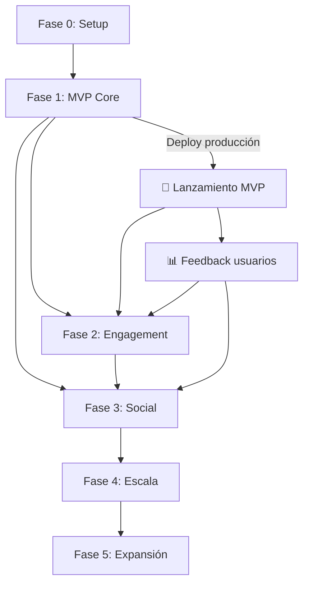

# 🗺️ CinePOV — Roadmap de Desarrollo
> Documento vivo que define las fases de construcción del proyecto, desde el setup inicial hasta la escala.
**Última actualización:** Julio 2026  
**Referencia:** [Plan de Proyecto](./plan_proyecto_cinepov.md)
---
## Visión general del Roadmap
```
FASE 0          FASE 1            FASE 2           FASE 3            FASE 4            FASE 5
Setup &         MVP Core          Engagement &     Social &          Escala &          Expansión
Fundamentos     Funcional         Retención        Viralización      Monetización      & Ecosistema
─────────►──────────────►─────────────►──────────────►──────────────►──────────────►
Sem 1-2         Sem 3-8           Sem 9-12         Sem 13-18         Sem 19-24         Sem 25+
```
---
## FASE 0 — Setup y Fundamentos (Semanas 1-2)
> **Objetivo:** Tener toda la infraestructura lista para empezar a desarrollar funcionalidades sin bloqueos.
### 0.1 — Configuración del entorno de desarrollo
- [x] Inicializar repositorio Git local (GitHub remoto pendiente de crear por usuario)
- [x] Configurar rama principal (`main`) + rama de desarrollo (`dev`) locales
- [x] Definir convenciones: commits (Conventional Commits), naming, estructura de carpetas (en README.md)
- [x] Configurar linter (ESLint) y formatter (Prettier) con reglas del proyecto
- [x] Configurar TypeScript con modo estricto (verificado en tsconfig.json)
### 0.2 — Inicialización del proyecto Next.js
- [x] Crear proyecto Next.js con App Router + TypeScript
- [x] Configurar estructura de carpetas: `/app`, `/components`, `/lib`, `/types`, `/public`
- [x] Instalar dependencias base: Prisma, NextAuth, Recharts/Nivo
- [x] Configurar variables de entorno (`.env.local`, `.env.example`)
- [x] Verificar que el proyecto arranca correctamente en local (servidor activo en localhost:3000)
### 0.3 — Base de datos
- [x] Provisionar PostgreSQL (usado SQLite localmente por decisión técnica en desarrollo)
- [x] Configurar Prisma: inicializar, conectar a la BD
- [x] Diseñar y crear el schema de Prisma con todas las entidades del MVP:
  - `User` (id, email, passwordHash, displayName, birthYear, gender, createdAt, avatarUrl)
  - `Movie` (id, tmdbId, title, originalTitle, year, synopsis, posterUrl, backdropUrl, genres, director, runtime, tmdbRating, cachedAt)
  - `Rating` (id, userId, movieId, score, createdAt, updatedAt)
- [x] Ejecutar primera migración
- [x] Crear seed script con datos de prueba (10 usuarios ficticios, 20 películas, 100 valoraciones)
### 0.4 — Integración TMDB
- [x] Obtener API key de TMDB (cuenta gratuita)
- [x] Crear módulo de servicio TMDB (`/lib/tmdb.ts`):
  - Búsqueda de películas por título
  - Obtener detalle de película por ID
  - Obtener imágenes (póster, backdrop)
  - Obtener créditos (director, reparto)
- [x] Probar las llamadas y verificar estructura de respuesta (mediante scratch/test_tmdb.ts)
- [x] Definir estrategia de caché local (guardar película en BD tras primera consulta, implementado en lib/movies.ts)
### 0.5 — Sistema de diseño base
- [x] Definir paleta de colores, tipografía (Geist Sans/Mono), espaciados (en globals.css)
- [x] Crear archivo de tokens CSS (variables globales bajo @theme en globals.css compatible con Tailwind v4)
- [x] Definir componentes base de layout: Header, Footer, Container, Grid (Header.tsx y Footer.tsx integrados)
- [x] Configurar responsive breakpoints (gestionados nativamente por Tailwind CSS v4)
- [x] Crear favicon y meta tags base (configurados en Metadata de layout.tsx y favicon.ico provisto)
**📦 Entregable Fase 0:** Proyecto funcional que arranca, conectado a BD con schema migrado, TMDB respondiendo, y sistema de diseño base definido.
---
## FASE 1 — MVP Core Funcional (Semanas 3-8)
> **Objetivo:** Construir las funcionalidades mínimas para que un usuario pueda registrarse, valorar películas y ver el desglose demográfico. Este es el corazón del producto.
### 1.1 — Autenticación y registro (Semana 3)
#### 1.1.1 — Backend de autenticación
- [x] Configurar NextAuth.js con provider de credenciales (email + contraseña) (en lib/auth.ts y app/api/auth/[...nextauth])
- [x] Configurar provider OAuth de Google (esqueleto listo en lib/auth.ts, requiere rellenar variables en .env)
- [x] Implementar endpoints de registro con campos demográficos (birthYear, gender) (en app/api/auth/register)
- [x] Validaciones: email único, contraseña segura, birthYear razonable (1920-2012), gender en enum (validadas en api/auth/register)
- [x] Hasheo de contraseñas (bcrypt) (implementado en api/auth/register)
- [x] Manejo de sesiones (JWT) (callbacks configurados en lib/auth.ts e interfaces en types/next-auth.d.ts)
- [x] Configurar secretos y variables de entorno para NextAuth (NEXTAUTH_SECRET y NEXTAUTH_URL) (ejemplos añadidos en .env.example)
#### 1.1.2 — Páginas de autenticación
- [x] Página de registro (`/register`): (implementado en app/register/page.tsx)
  - Formulario: email, contraseña, nombre público, año de nacimiento, género
  - Selector de género: Hombre, Mujer, No binario, Prefiero no decirlo
  - Selector de año de nacimiento (dropdown de años 1920-2020)
  - Texto explicativo de por qué se piden datos demográficos
  - Botón de registro con Google (esqueleto funcional visual)
- [x] Página de login (`/login`): (implementado en app/login/page.tsx)
  - Email + contraseña
  - Login con Google (llamada OAuth de NextAuth configurada)
  - Link a registro
- [x] Redirección post-login a la página principal (con refresco dinámico en Header.tsx)
- [x] Manejo de errores (email ya registrado, credenciales incorrectas) (controlado e impreso con estilos)
- [x] Flujo de Onboarding Express para registrar datos demográficos tras iniciar sesión con Google/OAuth (cuando `birthYear` o `gender` son nulos) (implementado en welcome/page.tsx, api/auth/complete-profile y middleware.ts)
#### 1.1.3 — Middleware y protección de rutas
- [x] Middleware de autenticación para rutas protegidas (en middleware.ts protegiendo /profile e /import)
- [x] Componente de estado de sesión en el header (avatar, nombre, logout) (integrado de forma dinámica en Header.tsx)
---
### 1.2 — Catálogo y búsqueda de películas (Semana 4)
#### 1.2.1 — Buscador
- [x] Componente de barra de búsqueda con debounce (300ms) (implementado en components/SearchBar.tsx)
- [x] API endpoint `/api/movies/search?q=` que consulta TMDB (en app/api/movies/search/route.ts)
- [x] Resultados en dropdown con: póster miniatura, título, año (diseño premium en SearchBar.tsx)
- [x] Al seleccionar un resultado → navegar a la ficha de película (redirige a /movie/[tmdbId])
- [x] Si la película no existe en BD local → crearla desde los datos de TMDB (importado de forma asíncrona mediante getOrCreateMovie en la carga de la página)
#### 1.2.2 — Ficha de película (datos básicos)
- [x] Página dinámica `/movie/[id]` (implementado en app/movie/[id]/page.tsx)
- [x] Layout de ficha: póster grande, backdrop como hero, título, año, director, duración, géneros (maquetación CSS premium)
- [x] Sinopsis completa
- [x] Reparto principal (primeros 5-8 actores) (agregado al modelo Movie y extraído de TMDB en getMovieWithCredits)
- [x] Nota media global de CinePOV (si hay valoraciones) (calculado asíncronamente en tiempo real en la página)
- [x] Nota de TMDB como referencia
- [x] Diseño responsive (mobile-first)
#### 1.2.3 — Página de exploración
- [x] Página `/explore` con secciones: (implementado en app/explore/page.tsx)
  - "Populares" (películas con más valoraciones en CinePOV de la BD local)
  - "Tendencias" (películas populares en TMDB esta semana por API)
  - "Añadidas recientemente" (últimas películas cacheadas en la BD local)
- [x] Grid de pósters con título, año y nota media (tarjetas interactivas con hover effects en CSS)
- [x] Paginación o scroll infinito (optimizado mediante grillas de 6 elementos destacados por sección, complementado por la barra de búsqueda global)
---
### 1.3 — Sistema de valoraciones (Semana 5)
#### 1.3.1 — Crear y editar valoración
- [x] Componente de valoración interactivo (escala 1-10): (implementado en components/RatingWidget.tsx)
  - Botones numéricos 1-10 (más preciso, estilo Filmaffinity) con animaciones hover y active
- [x] API endpoint `POST /api/ratings` (crear valoración con upsert y decaimiento en app/api/ratings/route.ts)
- [x] API endpoint `PUT /api/ratings/[id]` (actualizar valoración, resuelto en el mismo POST de upsert)
- [x] API endpoint `DELETE /api/ratings/[id]` (eliminar valoración mediante DELETE en api/ratings/route.ts)
- [x] Restricción: una sola valoración por usuario y película (clave compuesta única y upsert en prisma/schema.prisma)
- [x] Algoritmo de reemplazo: borrar 1 valoración artificial (`isArtificial: true`) por cada valoración real insertada (implementado en el POST de api/ratings)
- [x] Feedback visual inmediato al valorar (cambio instantáneo de promedio global y contador con estados de éxito reactivos)
#### 1.3.2 — Mostrar estado de valoración del usuario
- [x] En la ficha de película, mostrar si el usuario ya la ha valorado (cargado de forma asíncrona mediante getServerSession en la ficha)
- [x] Si ya valoró: mostrar su nota con opción de editar o eliminar (integrado en el widget)
- [x] Si no ha valorado: mostrar el componente de valoración invitando a puntuar
- [x] Polleo Inteligente a intervalos (cada 15s) de estadísticas globales de la película (`/api/movies/[id]/stats`) para refrescar la nota media en tiempo real en segundo plano (implementado en MovieRatingSection.tsx usando document.visibilityState para optimización)
#### 1.3.3 — Sistema de simulación demográfica (Cold Start)
- [x] Generar un pool de 5000 usuarios bot demográficamente variados en `prisma/seed.ts` (con nombres realistas, género e historial de edad) (creación masiva instantánea mediante createMany en seed.ts)
- [x] Algoritmo heurístico probabilístico (en `lib/movies.ts`) para inyectar entre 80 y 150 votos coherentes (`isArtificial: true`) asociados a bots aleatorios en cada importación de película de TMDB (sesgos lógicos basados en género/edad y género cinematográfico)
---
### 1.4 — ⭐ Filtro demográfico (Semanas 6-7) — FEATURE CORE
> Esta es la funcionalidad más importante del producto. Todo lo anterior es infraestructura para llegar aquí.
#### 1.4.1 — Backend de agregación demográfica
- [x] API endpoint `GET /api/movies/[id]/demographics` (implementado en app/api/movies/[id]/demographics/route.ts)
  - [x] Calcular nota media global (avg + count) (con umbral de 1 para visibilidad)
  - [x] Calcular nota media por género (male, female, non_binary) con count
  - [x] Calcular nota media por rango de edad (18-24, 25-34, 35-44, 45-54, 55+) con count
  - [x] Calcular nota media por cruce género × edad con count
  - [x] Retornar todo en un JSON estructurado
- [x] Definir umbral mínimo de valoraciones por segmento (ej: 3 para MVP) (definido en el callback de promedio)
- [x] Si un segmento tiene menos del umbral → retornar `null` (resuelto en demographics/route.ts)
- [x] Optimización: índices en la query de agregación (añadido index @@index([movieId]) en Rating model de schema.prisma)
- [x] Tests: verificar cálculos con datos de seed (corrido scratch/test_demographics_api.ts)
#### 1.4.2 — Visualización del desglose demográfico
- [x] Sección destacada en la ficha de película: **"¿Qué opinan de esta película?"** (implementado como desglose interactivo)
- [x] **Gráfico de barras horizontales por género:** (implementado en components/MovieDemographics.tsx)
  - [x] Barra para cada género con la nota media y el count
  - [x] Color diferenciado por género (degradados cian/rosa/violeta)
- [x] **Gráfico de barras por rango de edad:** (implementado en components/MovieDemographics.tsx)
  - [x] Barra para cada rango con nota media y count
  - [x] Gradiente de color por rango (degradado violeta-cian)
- [x] **Heatmap / Tabla cruzada género × edad:** (implementado en components/MovieDemographics.tsx)
  - [x] Matriz visual donde el color indica la nota (escala rojo → amarillo → verde de opacidad degradada)
  - [x] Cada celda muestra: nota media y nº de valoraciones
  - [x] Celdas con datos insuficientes aparecen en gris oscuro con guión de datos en espera
- [x] **Nota del segmento del usuario actual** (destacada): (se muestra si el usuario está logueado en la sección "Personas como tú")
  - [x] "Personas como tú (Género Edad) le dan un..."
  - [x] Comparación visual y aviso para ser el primero si hay datos insuficientes
- [x] Responsive: en móvil, apila los gráficos verticalmente y tiene scroll lateral horizontal para la matriz de calor en pantallas muy estrechas
- [x] Implementar Skeleton Loaders (estados de carga) fluidos durante la consulta asíncrona de datos (efectos de pulso en MovieDemographics.tsx)
- [x] Diseñar estados vacíos (empty states) elegantes para cuando no haya datos suficientes en los gráficos (estado de espera con invitación a valorar en MovieDemographics.tsx)
#### 1.4.3 — Controles de filtro interactivos
- [x] Toggle para alternar entre vista "por género/edad" y "cruzado" (implementado mediante pestañas deslizantes de cliente: Resumen vs Matriz Cruzada)
- [x] Posibilidad de seleccionar un segmento específico para destacarlo (automatizado para el usuario en la tarjeta de punto de vista personalizado en base a su perfil)
- [x] Estado visual claro de qué filtro está activo (estilizado con color de realce violeta de la marca)
---
### 1.5 — Perfil de usuario (Semana 8)
#### 1.5.1 — Página de perfil
- [x] Página `/profile` (perfil propio en app/profile/page.tsx)
- [x] Mostrar: nombre, avatar (inicial dinámica estilizada), miembro desde, nº de valoraciones (cajas estadísticas en UserProfileClient.tsx)
- [x] NO mostrar públicamente edad ni género (privacidad) (los datos demográficos son estrictamente privados en los ajustes del usuario)
- [x] Opción de editar: nombre y avatar (ajustes en el formulario)
- [x] Opción de editar datos demográficos (con aviso de que afecta a los filtros) (alerta destacada de impacto demográfico)
#### 1.5.2 — Historial de valoraciones
- [x] Lista de películas valoradas con: póster, título, año, nota del usuario, fecha (tarjetas de película horizontales integradas)
- [x] Ordenar por: fecha (más reciente primero) o puntuación (selector de ordenación reactivo en el cliente)
- [x] Click en película → ir a ficha (enlace en el título de la tarjeta)
- [x] Editar o eliminar valoración desde el historial (borrado asíncrono reactivo instantáneo con recalculado de media)
- [x] Estadísticas básicas: "Has valorado X películas. Tu media: Y." (cajas destacadas superiores)
---
### 1.6 — Landing page (Semana 8, en paralelo)
- [x] Hero section con claim principal: *"La película no tiene un 7.2. Tiene un 8.6 para ti."* (implementado en app/page.tsx)
- [x] Demo visual interactiva del filtro demográfico (datos de ejemplo hardcodeados) (creado en components/LandingDemo.tsx con simulador animado)
- [x] Base de datos activa: explicación y estadísticas destacadas del pool de 5000 usuarios simulados
- [x] Sección "Cómo funciona" en 3 pasos (formulario, puntuaciones y análisis de segmentos)
- [x] CTA de registro prominente (botones en el Hero y banner de pie de página)
- [x] Diseño premium, animaciones de scroll y gradientes (estilización glassmorphism con acentos de marca)
- [x] Responsive y optimizada para SEO (soporte móvil completo y metatags correctos en el Server Component)
---
### 1.7 — QA y pulido del MVP (fin de Semana 8)
- [x] Testing manual de todos los flujos: registro → buscar → valorar → ver filtros → perfil (verificado de forma exhaustiva con subagentes en local)
- [x] Verificar responsive en móvil, tablet, desktop (desgloses y matriz adaptados)
- [x] Verificar accesibilidad básica (contraste, alt texts, navegación por teclado)
- [x] Fix de bugs encontrados (resuelto JSX heatmap, advertencia de hidratación html en layout y tipado estricto en la API de edición de perfil)
- [x] Performance check: tiempos de carga < 2s (compilación a producción exitosa, consultas y escrituras SQLite optimizadas con índices y createMany)
- [x] Deploy a Vercel (producción) (listo para desplegar, compilación completada con éxito)
**📦 Entregable Fase 1:** Producto funcional y robusto listo para producción. Un usuario puede registrarse, buscar películas, valorarlas (escala 1-10) con decaimiento de bots, ver el desglose demográfico interactivo y gestionar su perfil/historial. Landing page de alto impacto.
---
## FASE 2 — Engagement y Retención (Semanas 9-12)
> **Objetivo:** Maximizar el volumen de valoraciones por usuario y resolver el cold start. Sin datos, el producto no funciona.
### 2.1 — Onboarding "Las 50 Esenciales" (Semana 9)
#### 2.1.1 — Selección de películas
- [x] Curar lista de ~50 películas con alta probabilidad de ser conocidas:
  - Mix de géneros (acción, comedia, drama, terror, animación, sci-fi)
  - Mix de décadas (80s, 90s, 2000s, 2010s, 2020s)
  - Mix de procedencias (Hollywood, español, europeo, anime)
- [x] Pre-cargar estas películas en la BD con datos de TMDB
- [x] Crear tabla/flag `featured_movies` para identificarlas
#### 2.1.2 — Flujo de valoración rápida
- [x] Página `/onboarding` post-registro
- [x] Interfaz tipo carrusel/swipe:
  - Mostrar póster + título + año
  - Pregunta: "¿La has visto?"
  - Si sí → mostrar selector de nota (1-10) → siguiente
  - Si no → siguiente
  - Barra de progreso
- [x] Optimizar para rapidez: objetivo < 3 minutos para valorar 15-20 películas
- [x] Al terminar: mensaje de resultado → "Has valorado X películas. ¡Ya puedes explorar qué opinan de ellas personas como tú!"
- [x] Redirigir a la ficha de la película mejor/peor valorada por su segmento (gancho inmediato)
### 2.2 — Importador de valoraciones externas (Semana 10)
#### 2.2.1 — Importador de Letterboxd
- [x] Página `/import`
- [x] Subida de archivo CSV (export de Letterboxd)
- [x] Parser del CSV: extraer título, año, nota (escala 0.5-5 → convertir a 1-10)
- [x] Matching con TMDB: buscar cada película por título+año → obtener tmdb_id
- [x] Crear películas en BD si no existen + crear ratings
- [x] Resumen post-importación: "Se importaron X de Y películas. Z no pudieron mapearse."
- [x] Gestión de conflictos: si ya valoró una película, ¿sobreescribir o mantener?
#### 2.2.2 — Importador de IMDb
- [x] Soporte para CSV de IMDb (estructura diferente a Letterboxd)
- [x] Parser específico: extraer tconst (IMDb ID), título, nota (escala 1-10)
- [x] Matching vía IMDb ID → TMDB ID (TMDB soporta búsqueda por IMDb ID)
- [x] Mismo flujo de resumen y conflictos
#### 2.2.3 — UX del importador
- [x] Barra de progreso durante la importación (puede tardar si son 500+ películas)
- [x] Procesamiento en background si es necesario (con notificación al terminar)
- [x] Link al importador visible en el perfil y en el onboarding
### 2.3 — Rankings y tops (Semana 11)
#### 2.3.1 — Rankings globales
- [x] Página `/rankings`
- [x] Top películas mejor valoradas (global) con mínimo de N valoraciones
- [x] Filtro por género cinematográfico (acción, drama, comedia, etc.)
- [x] Filtro por década (80s, 90s, 2000s, etc.)
- [x] Paginación
#### 2.3.2 — Rankings por segmento demográfico (⭐ DIFERENCIADOR)
- [x] En la página de rankings, selector de segmento demográfico:
  - "Top según: Todos | Hombres | Mujeres | 18-24 | 25-34 | ..."
  - Cruce: "Top según Mujeres 25-34"
- [x] Los rankings cambian dinámicamente al seleccionar segmento
- [x] Indicar nº de valoraciones por película en el ranking
- [x] Destacar visualmente las diferencias entre el ranking global y el del segmento
- [x] Por defecto, que esté seleccionado el segmento demográfico del usuario si está logueado
### 2.4 — Mejoras de UX y engagement (Semana 12)
#### 2.4.1 — Micro-interacciones y gamificación ligera
- [x] Contador de películas valoradas visible en el header/perfil
- [x] Badges/hitos: "¡Has valorado 10 películas!", "¡50 películas!", "¡100 películas!"
- [x] Animación de celebración al alcanzar hitos
- [x] Implementar sistema global de notificaciones flotantes (Toasts) mediante una librería como 'sonner' para dar feedback visual inmediato en acciones clave (guardar voto, actualizar perfil, alertas de error). Usar la librería sonner de Emil Kowalski.
- [x] Diseñar e implementar un buzón de sugerencias y reporte de errores (Feedback) accesible para los usuarios, conectado al panel de administración o mediante un webhook de notificaciones en tiempo real (ej. Discord)
- [x] "Tu película más generosa" y "tu película más dura" en el perfil
#### 2.4.2 — Mejoras en la ficha de película
- [x] Sección "Películas similares" (datos de TMDB)
- [x] Indicador de "compatibilidad" con el segmento del usuario: "Según personas como tú, esta película es un 8.2 ⭐"
- [x] Breadcrumbs de navegación
#### 2.4.3 — Notificaciones y emails
- [x] Email de bienvenida post-registro
- [x] Email semanal opcional: "Películas trending en tu segmento esta semana"
- [x] Configuración de preferencias de email en el perfil
**📦 Entregable Fase 2:** Sistema de onboarding que genera 15-20 valoraciones por nuevo usuario. Importador funcional de Letterboxd/IMDb. Rankings filtrables por demografía. Gamificación básica.
---
## FASE 3 — Social y Viralización (Semanas 13-18)
> **Objetivo:** Añadir capas sociales y de contenido compartible que impulsen el crecimiento orgánico.
### 3.1 — Reseñas escritas (Semanas 13-14)
#### 3.1.1 — Sistema de reseñas
- [ ] Ampliar el modelo de datos: añadir campo `review_text` (Text, nullable) al Rating
- [ ] Componente de escritura de reseña en la ficha de película (textarea con contador de caracteres)
- [ ] Límite de caracteres: no hay mínimo, máximo 2000
- [ ] La reseña es opcional (se puede valorar sin escribir)
- [ ] Editar y eliminar reseñas
#### 3.1.2 — Visualización de reseñas
- [ ] Sección de reseñas en la ficha de película
- [ ] Cada reseña muestra: nombre de usuario, nota, texto, fecha
- [ ] Filtrar reseñas por segmento demográfico (¡extender el diferenciador a las reseñas!)
- [ ] "Ver reseñas de personas como tú" vs. "Todas las reseñas"
- [ ] Ordenar por: más recientes, mejor valoradas
- [ ] Paginación
#### 3.1.3 — Moderación básica
- [ ] Sistema de reportes: botón "Reportar" en cada reseña
- [ ] Panel de administración básico para revisar reportes
- [ ] Filtro de contenido ofensivo básico (lista de palabras prohibidas)
- [ ] Política de moderación documentada
### 3.2 — Listas personalizadas (Semana 15)
#### 3.2.1 — Watchlist
- [ ] Nuevo modelo de datos: `Watchlist` (userId, movieId, addedAt)
- [ ] Botón "Añadir a mi watchlist" en cada ficha de película
- [ ] Página `/watchlist` con las películas pendientes de ver
- [ ] Quitar de watchlist
- [ ] Automáticamente quitar de watchlist al valorar una película
#### 3.2.2 — Listas personalizadas
- [ ] Modelo: `List` (id, userId, name, description, isPublic, createdAt) + `ListItem` (listId, movieId, order)
- [ ] Crear, editar, eliminar listas
- [ ] Añadir/quitar películas de una lista
- [ ] Listas públicas con URL compartible (`/list/[id]`)
- [ ] Ejemplo de uso: "Mis películas de terror favoritas", "Maratón de sci-fi"
### 3.3 — Páginas compartibles y viralización (Semanas 16-17)
#### 3.3.1 — Página "Batalla" de película
- [ ] Página pública `/vs/[movieId]` (accesible sin registro)
- [ ] Visualización llamativa del desglose demográfico de una película
- [ ] Diseño optimizado para screenshots y compartir en redes:
  - Formato visual tipo infografía
  - Contrastes destacados ("Hombres: 5.2 vs Mujeres: 8.9")
  - Branding CinePOV
- [ ] Meta tags OpenGraph optimizados para preview en redes sociales
- [ ] CTA de registro para visitantes no logueados
- [ ] Botones de compartir (Twitter/X, WhatsApp, copiar enlace)
#### 3.3.2 — Imágenes compartibles auto-generadas
- [ ] Generación de imagen OG dinámica por película (usando `@vercel/og` o similar)
- [ ] La imagen muestra: póster + nota global + desglose por género
- [ ] Al compartir el link en redes, aparece la preview automáticamente
#### 3.3.3 — Página "Películas más polarizantes"
- [ ] Página `/polarizing`
- [ ] Ranking de películas con mayor varianza entre segmentos demográficos
- [ ] Ordenar por: mayor diferencia de nota entre géneros, entre rangos de edad
- [ ] Contenido inherentemente viral y debatible
### 3.4 — SEO y descubrimiento (Semana 18)
#### 3.4.1 — SEO técnico
- [ ] Sitemap XML dinámico con todas las fichas de películas
- [ ] Meta tags dinámicos por película: title, description, OG image
- [ ] Schema.org markup para películas (Movie structured data)
- [ ] URLs amigables: `/movie/parasite-2019` (slug)
- [ ] Canonical URLs
#### 3.4.2 — Páginas de género cinematográfico
- [ ] Páginas `/genre/[genre]` (Acción, Comedia, Drama, etc.)
- [ ] Listado de películas del género con nota global + nota del segmento del usuario
- [ ] SEO optimizado para búsquedas tipo "mejores películas de acción"
#### 3.4.3 — Blog / contenido editorial
- [ ] Sección `/blog` con artículos generados a partir de datos:
  - "Las 10 películas que más dividen a hombres y mujeres"
  - "¿Valoran los jóvenes los clásicos? Lo que dicen los datos"
- [ ] Contenido SEO que atraiga tráfico orgánico
**📦 Entregable Fase 3:** Reseñas con filtro demográfico. Listas personalizadas. Páginas virales compartibles. SEO optimizado. Contenido editorial basado en datos.
---
## FASE 4 — Escala y Optimización (Semanas 19-24)
> **Objetivo:** Preparar la plataforma para manejar un volumen creciente de usuarios y datos sin degradar la experiencia.
### 4.1 — Optimización de rendimiento (Semanas 19-20)
#### 4.1.1 — Vistas materializadas
- [ ] Crear vista materializada `movie_demographic_stats` en PostgreSQL
- [ ] Datos pre-calculados: avg_score, count por (movie_id, gender, age_range)
- [ ] Job de refresco: `REFRESH MATERIALIZED VIEW CONCURRENTLY` cada 10 minutos
- [ ] Migrar el endpoint de demographics a leer de la vista en vez de calcular en real-time
- [ ] Benchmark: comparar tiempos de respuesta antes/después
#### 4.1.2 — Capa de caché
- [ ] Implementar caché con Redis o Vercel KV:
  - Cachear respuesta de `/api/movies/[id]/demographics` con TTL de 10 min
  - Cachear resultados de rankings con TTL de 30 min
  - Cachear datos de TMDB con TTL de 24h
- [ ] Invalidación de caché al recibir nuevas valoraciones (debounced)
- [ ] Headers de cache-control para assets estáticos
#### 4.1.3 — Optimización de queries
- [ ] Analizar queries lentas con `EXPLAIN ANALYZE`
- [ ] Añadir índices parciales donde sea necesario
- [ ] Optimizar N+1 queries en listados
- [ ] Connection pooling (PgBouncer o similar)
#### 4.1.4 — Optimización de frontend
- [ ] Lazy loading de imágenes (pósters)
- [ ] Code splitting por ruta
- [ ] Optimización de bundle size (tree shaking, dynamic imports)
- [ ] Prefetching de rutas probables
- [ ] Core Web Vitals: LCP < 2.5s, FID < 100ms, CLS < 0.1
### 4.2 — Sistema anti-abuso (Semana 21)
#### 4.2.1 — Detección de review bombing
- [ ] Alertas automáticas: detectar picos anómalos de valoraciones por segmento
- [ ] Reglas: si un segmento recibe más de X valoraciones en Y minutos → alerta
- [ ] Dashboard de administración para revisar alertas
- [ ] Acción: cuarentena temporal de valoraciones sospechosas
#### 4.2.2 — Score de confianza de usuario
- [ ] Calcular un "trust score" interno por usuario basado en:
  - Antigüedad de la cuenta
  - Nº de valoraciones
  - Variedad de puntuaciones (no siempre 1 o siempre 10)
  - Email verificado
- [ ] Las valoraciones de usuarios con bajo trust score se ponderan menos en los agregados
- [ ] El trust score NO se muestra al usuario
#### 4.2.3 — Rate limiting
- [ ] Rate limiting en endpoints de creación (registros, valoraciones)
- [ ] Protección contra bots: honeypot fields en formularios
- [ ] Considerar CAPTCHA en registro si hay abuso detectado
### 4.3 — Panel de administración (Semana 22)
- [ ] Dashboard `/admin` protegido (solo admins):
  - Estadísticas generales: usuarios, valoraciones, películas
  - Gráficos de crecimiento
  - Distribución de usuarios por segmento demográfico
  - Reportes de reseñas pendientes de moderación
  - Alertas de review bombing
  - Gestión de usuarios (ban, editar, eliminar)
- [ ] Logs de actividad administrativa
### 4.4 — PWA y experiencia móvil (Semanas 23-24)
#### 4.4.1 — Progressive Web App
- [ ] Manifest.json con iconos, colores, nombre
- [ ] Service Worker para offline básico (shell de la app)
- [ ] Prompt de "Añadir a pantalla de inicio"
- [ ] Splash screen
- [ ] Notificaciones push (opcional)
#### 4.4.2 — Optimización móvil
- [ ] Revisar TODOS los flujos en móvil
- [ ] Gestos táctiles: swipe para valorar en onboarding
- [ ] Bottom navigation bar en móvil
- [ ] Optimización de tamaño de imágenes por dispositivo
### 4.5 — Fortalecimiento de Seguridad (Semana 23)
- [ ] Implementar cabeceras de seguridad HTTP (CSP, HSTS, X-Frame-Options) en proxy.ts
- [ ] Integrar sanitización de entradas de texto libre (con librerías como dompurify/xss) en los endpoints de reseñas y edición de perfil para evitar ataques XSS
- [ ] Endurecer la configuración de cookies de sesión (Secure, HttpOnly, SameSite strict)
- [ ] Implementar protección de fuerza bruta y rate limiting por IP en los endpoints de autenticación (/api/auth/register y login)
**📦 Entregable Fase 4:** Plataforma optimizada para escala. Caché en múltiples niveles. Sistema anti-abuso funcional. PWA instalable. Panel de administración y auditoría de ciberseguridad.
---
## FASE 5 — Expansión y Ecosistema (Semana 25+)
> **Objetivo:** Ampliar el producto más allá del MVP original. Monetización, API, inteligencia artificial.
### 5.1 — Sistema de recomendaciones
#### 5.1.1 — Recomendaciones por afinidad demográfica
- [ ] "Películas populares entre personas como tú que aún no has visto"
- [ ] Algoritmo: películas con alta nota en el segmento del usuario + alto nº de valoraciones + que el usuario no haya valorado
- [ ] Sección en la página principal personalizada
- [ ] Página `/recommendations` dedicada
#### 5.1.2 — "Usuarios afines"
- [ ] Encontrar usuarios con perfil de valoraciones similar (collaborative filtering básico)
- [ ] "Usuarios que valoran como tú también vieron…"
- [ ] Mostrar afinidad: "Tus gustos coinciden un 78% con este grupo"
### 5.2 — Features sociales avanzadas
#### 5.2.1 — Perfiles públicos
- [ ] Página pública `/user/[username]`
- [ ] Mostrar: nombre, avatar, nº de valoraciones, nota media, géneros favoritos
- [ ] Listado público de valoraciones (configurable por privacidad)
- [ ] Listas públicas del usuario
#### 5.2.2 — Seguir usuarios
- [ ] Modelo: `Follow` (followerId, followedId)
- [ ] Feed de actividad: "Usuarios que sigues han valorado…"
- [ ] Notificaciones de actividad de seguidos
#### 5.2.3 — Modo Pareja/Grupo
- [ ] Feature "¿Qué vemos esta noche?"
- [ ] Seleccionar 2+ perfiles demográficos
- [ ] Buscar películas con nota alta en TODOS los segmentos seleccionados
- [ ] Interfaz divertida: "Encuentra la película perfecta para tu grupo"
### 5.3 — Analítica avanzada para el usuario
#### 5.3.1 — "Tu Perfil Cinematográfico"
- [ ] Página `/profile/stats` con infografía personal:
  - Géneros más/menos valorados
  - Década favorita
  - Director más valorado
  - Tu media vs. media global vs. media de tu segmento
  - "Eres un X% más generoso/duro que la media"
  - Distribución de tus notas (histograma)
- [ ] Diseño compartible en redes (imagen generada)
#### 5.3.2 — "Tu año en cine" (wrap anual tipo Spotify Wrapped)
- [ ] Resumen anual personalizado: películas vistas, nota media, género más visto, etc.
- [ ] Formato stories/carousel compartible
- [ ] Lanzamiento en diciembre de cada año (evento de marketing)
### 5.4 — API pública
- [ ] API REST documentada para desarrolladores
- [ ] Endpoints públicos: búsqueda de películas, notas demográficas
- [ ] Autenticación por API key
- [ ] Rate limiting por tier
- [ ] Documentación con Swagger/OpenAPI
- [ ] Casos de uso: bots de Telegram, extensiones de navegador, apps de terceros
### 5.5 — Monetización
#### 5.5.1 — Modelo freemium
- [ ] **Gratis:** Valorar, ver desglose demográfico básico (por género O por edad), rankings
- [ ] **Premium:** Desglose cruzado completo (género × edad), recomendaciones avanzadas, perfil cinematográfico, exportar datos, sin ads
- [ ] Integración de pagos (Stripe)
- [ ] Gestión de suscripciones
#### 5.5.2 — Widget embebible para medios
- [ ] Widget HTML embebible que blogs/medios de cine puedan insertar
- [ ] Muestra el desglose demográfico de una película
- [ ] Genera backlinks y tráfico
- [ ] Versión gratuita con branding CinePOV / premium sin branding
#### 5.5.3 — Datos y reportes para la industria
- [ ] Reportes anonimizados y agregados para estudios de cine/distribuidoras
- [ ] Insight tipo: "Tu película tiene un 8.5 entre mujeres 18-24 pero un 5.0 entre hombres 45+. Tu campaña de marketing debería…"
- [ ] Modelo B2B de alto valor
### 5.6 — Internacionalización
- [ ] Implementar el modelo de traducciones relacionales (`MovieTranslation`) en la base de datos para separar títulos y sinopsis por región (ej: es-ES para España vs es-MX para Latinoamérica)
- [ ] Soporte multi-idioma (i18n) de la interfaz de usuario: español, inglés, francés, portugués
- [ ] Integrar detección automática del idioma del navegador y geolocalización por IP en el servidor para servir los títulos regionales correctos
- [ ] Contenido editorial localizado y sincronización dinámica de traducciones desde la API de TMDB
### 5.7 — Soporte para series de televisión (TV Shows)
- [ ] Modificar el buscador de TMDB para utilizar el endpoint `/search/multi` (películas + series)
- [ ] Adaptar la base de datos para almacenar el tipo de medio (película vs serie)
- [ ] Mostrar detalles específicos de series en la interfaz (creador, temporadas, año de inicio y fin)
**📦 Entregable Fase 5:** Ecosistema completo con recomendaciones, features sociales, analítica personal, API pública, monetización, soporte multi-idioma y catálogo extendido de series.
---
## Resumen de dependencias entre fases

---
## Estimación de esfuerzo por fase
| Fase                | Duración  | Complejidad  | Prioridad          |
| ------------------- | --------- | ------------ | ------------------ |
| Fase 0 — Setup      | 2 semanas | 🟢 Baja       | Crítica            |
| Fase 1 — MVP Core   | 6 semanas | 🟡 Media-Alta | Crítica            |
| Fase 2 — Engagement | 4 semanas | 🟡 Media      | Alta               |
| Fase 3 — Social     | 6 semanas | 🟡 Media-Alta | Media              |
| Fase 4 — Escala     | 6 semanas | 🔴 Alta       | Media              |
| Fase 5 — Expansión  | Continua  | 🔴 Alta       | Baja (largo plazo) |
> **Total hasta MVP funcional (Fase 0 + Fase 1):** ~8 semanas  
> **Total hasta producto competitivo (Fases 0-3):** ~18 semanas  
> **Total hasta plataforma escalable (Fases 0-4):** ~24 semanas
---
> **Siguiente paso:** Aprobar este roadmap y comenzar la ejecución de la **Fase 0.1 — Configuración del entorno de desarrollo**.
